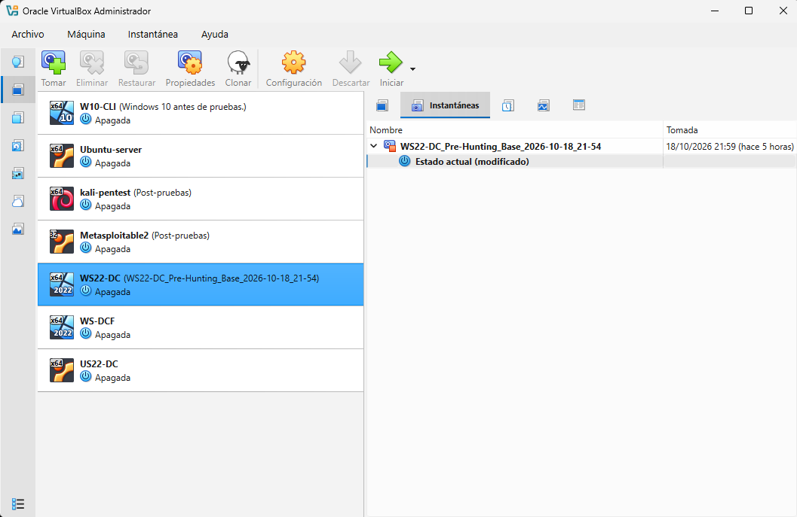
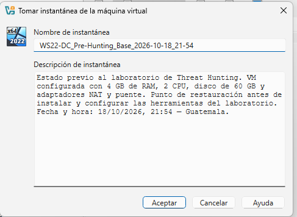

# Infraestructura

Creación de la VM, instalación de Windows Server, recursos, red e instantáneas.

## Requisitos

Necesitas un equipo con al menos 4 GB de RAM y conexión a Internet. Todo el laboratorio es gratuito.

- VirtualBox o VMware Workstation Player instalado en tu equipo.
- Espacio libre en disco: 50 GB para la máquina virtual.
- Recursos recomendados para la VM: 2 CPU y 4 GB de RAM.
- Un correo electrónico para la cuenta de Elastic Cloud.

## 1. Crear la máquina virtual con Windows Server 2022

Este paso reemplaza al de AWS: la VM corre en tu propio equipo con la versión de evaluación de Windows Server 2022, que Microsoft ofrece gratis por unos 180 días.

### 1.1 Descargar la ISO

1. Abre Windows Server 2022 en el Evaluation Center:  
   https://www.microsoft.com/es-es/evalcenter/download-windows-server-2022
2. Elige la descarga en formato ISO y completa el formulario.

*Figura 1. Página de descarga de Windows Server 2022 en el Evaluation Center (opción ISO, edición de 64 bits).*

3. Selecciona el idioma y guarda el archivo.

### 1.2 Crear la VM

#### VirtualBox

1. Pulsa **Nueva**.
2. Escribe un nombre, selecciona la ISO y elige tipo **Microsoft Windows** y versión **Windows 2022 (64-bit)**.
3. Asigna **4096 MB** de memoria y **2** procesadores.

*Figura 2. Asignación de 4 GB de RAM.*

*Figura 3. Asignación de 2 CPU.*

4. Crea un disco virtual de **50 GB**.

*Figura 4. Disco virtual de 50 GB.*

5. Verifica en **Configuración → Red** que el adaptador esté en **NAT**.

*Figura 5. Adaptador de red en modo NAT.*

### 1.3 Instalar Windows

1. Inicia la VM y sigue el asistente.
2. Edición: **Windows Server 2022 Standard Evaluation (Desktop Experience)**.
3. Instalación: **Custom** sobre el disco virtual.
4. Define la contraseña de **Administrator**.
5. Inicia sesión con esa contraseña.

### 1.4 Verificar y proteger

1. Abre el navegador y confirma que hay Internet.
2. Si bloquea descargas, desactiva **IE Enhanced Security Configuration** en Server Manager.
3. Crea una instantánea (snapshot) de la VM.

*Figura 6. Instantánea de la VM.*

*Figura 7. Configuración de la instantánea.*
