# Telemetría

## 2. Descargar e instalar Sysmon

Sysmon se instala dentro de la VM de Windows. Todos los comandos se ejecutan en PowerShell abierto como Administrador.

### 2.1 Descargar los archivos

1. Descarga **Sysmon.zip** desde Sysinternals:  
   https://learn.microsoft.com/es-mx/sysinternals/downloads/sysmon  
   También puedes usar la copia incluida en este repositorio: [`Sysmon.zip`](Sysmon.zip).

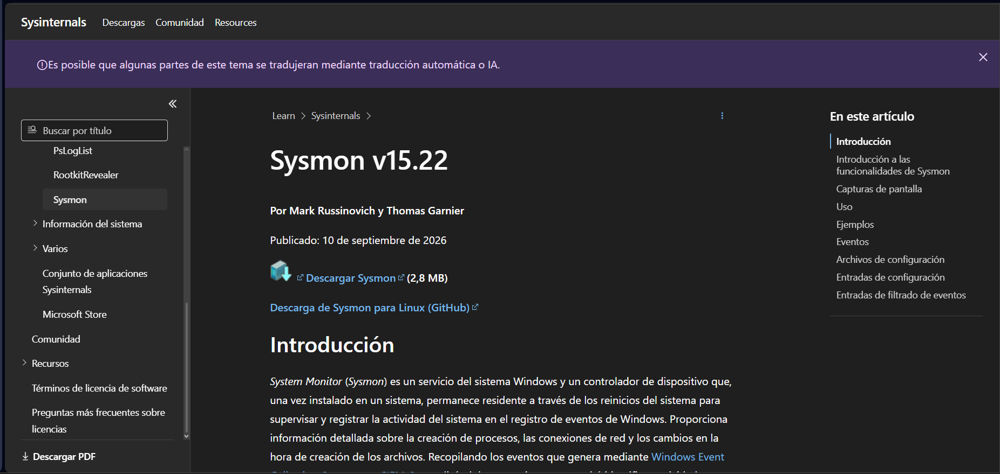

*Figura 1. Página de Sysmon en Sysinternals con el botón Descargar Sysmon.*

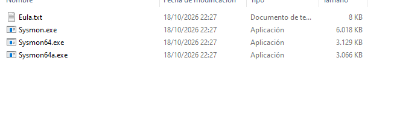

*Figura 2. Contenido de descarga zip.*

2. Abre la [configuración de SwiftOnSecurity](https://github.com/SwiftOnSecurity/sysmon-config/blob/master/sysmonconfig-export.xml) y descarga el archivo `sysmonconfig-export.xml` con el botón de descarga (o Raw y guardar como).

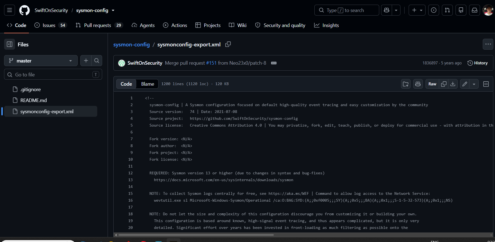

*Figura 3. Archivo sysmonconfig-export.xml de SwiftOnSecurity en GitHub (botón de descarga).*

3. Descomprime `Sysmon.zip` en una carpeta, por ejemplo `C:\Sysmon`.
4. Copia `sysmonconfig-export.xml` en esa misma carpeta.

### 2.2 Instalar

1. Abre PowerShell como Administrador.
2. Ejecuta:

```powershell
cd C:\Sysmon
.\Sysmon64.exe -accepteula -i sysmonconfig-export.xml
```

3. Al final debe indicar que Sysmon se instaló y se inició.

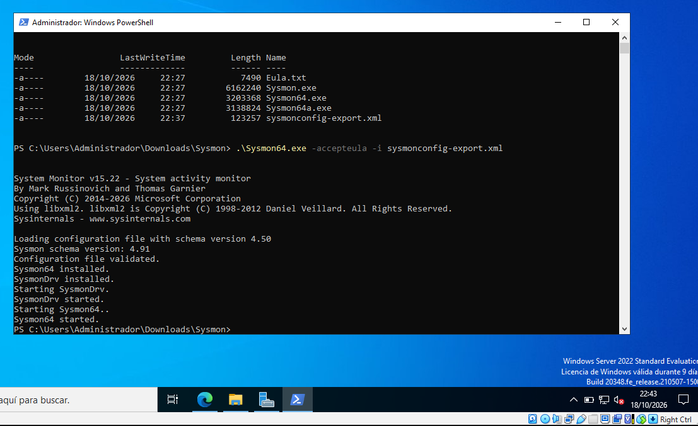

*Figura 4. Instalación de Sysmon en PowerShell con el archivo de configuración.*

### 2.3 Verificar

1. Comprueba que el servicio esté en ejecución. El nombre puede ser `Sysmon64` o `Sysmon`:

```powershell
Get-Service | Where-Object { $_.Name -like "*sysmon*" }
```

2. Comprueba que se generan eventos:

```powershell
Get-WinEvent -LogName "Microsoft-Windows-Sysmon/Operational" -MaxEvents 5
```

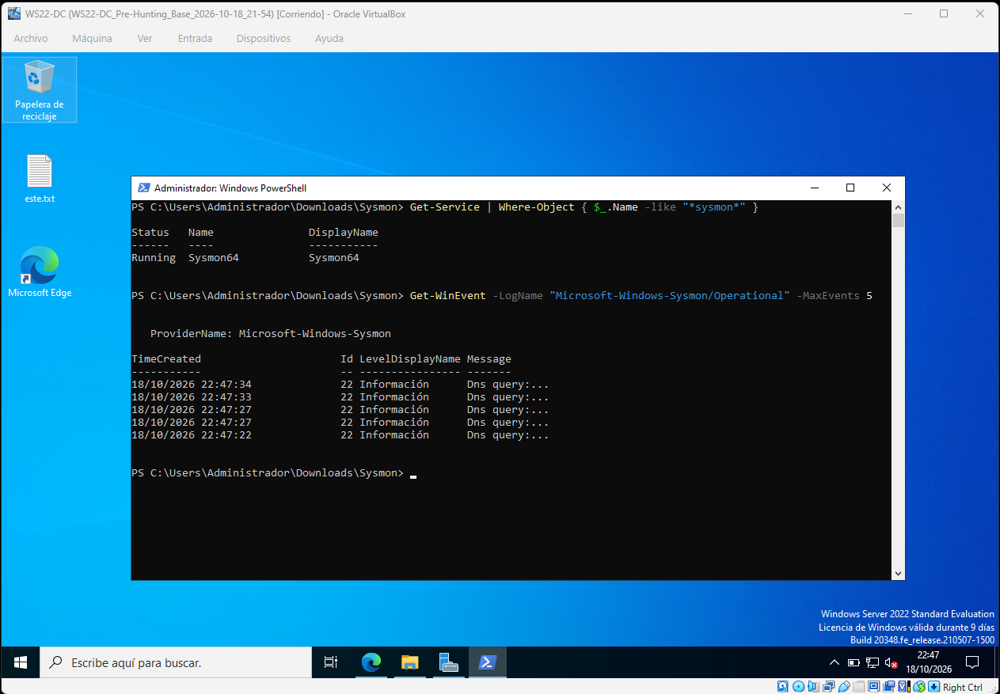

*Figura 5. Generación de eventos de Sysmon en PowerShell.*

3. También puedes verlo en **Event Viewer → Applications and Services Logs → Microsoft → Windows → Sysmon → Operational**.

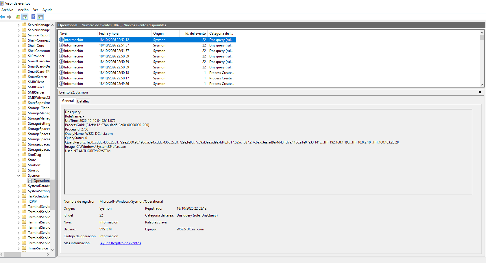

*Figura 6. Event Viewer: eventos de Sysmon en Applications and Services Logs → Microsoft → Windows → Sysmon → Operational.*

## 3. Registrarse en Elastic Cloud

La cuenta de prueba es gratuita por 14 días y no depende de la VM. Hazlo desde el navegador de tu equipo anfitrión.

1. Abre https://cloud.elastic.co/registration
2. Regístrate con tu correo y una contraseña, o con una cuenta de Google o Microsoft.

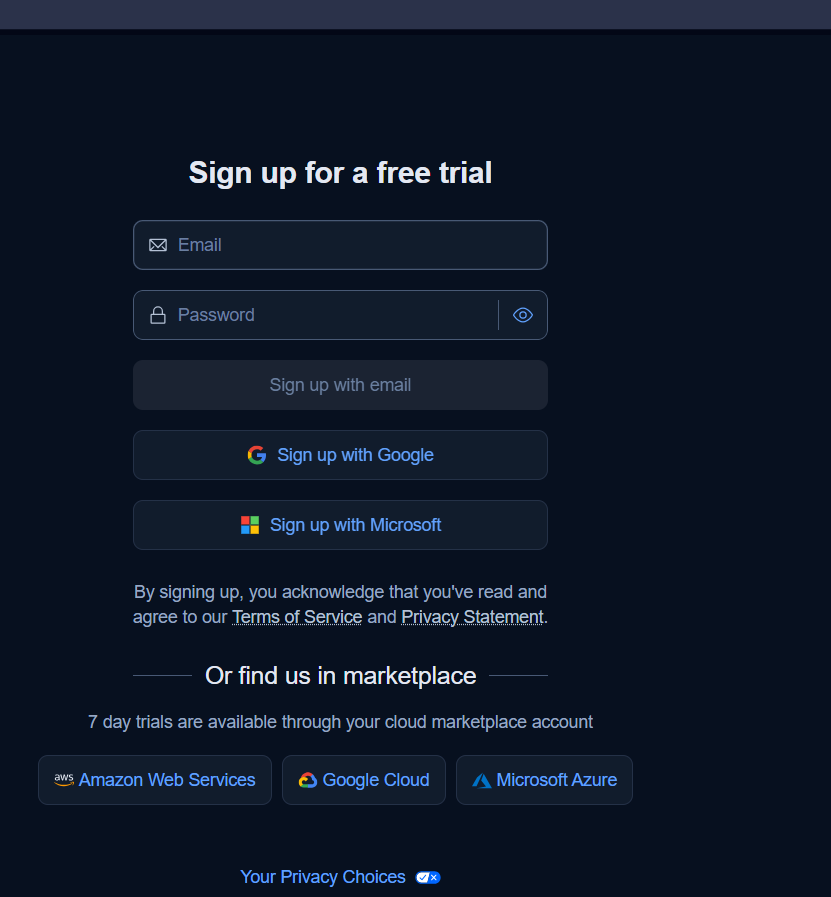

*Figura 7. Registro en Elastic Cloud (Sign up for a free trial).*

3. Confirma tu correo si Elastic lo solicita y completa nombre y apellido en la ventanilla inicial.

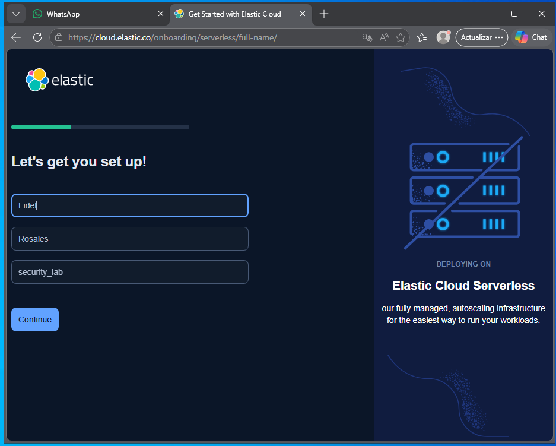

*Figura 8. Ventanilla inicial con campos de nombre y apellido.*

4. En el asistente de bienvenida, elige **Security** como caso de uso (detección de amenazas, SIEM y protección de endpoints).

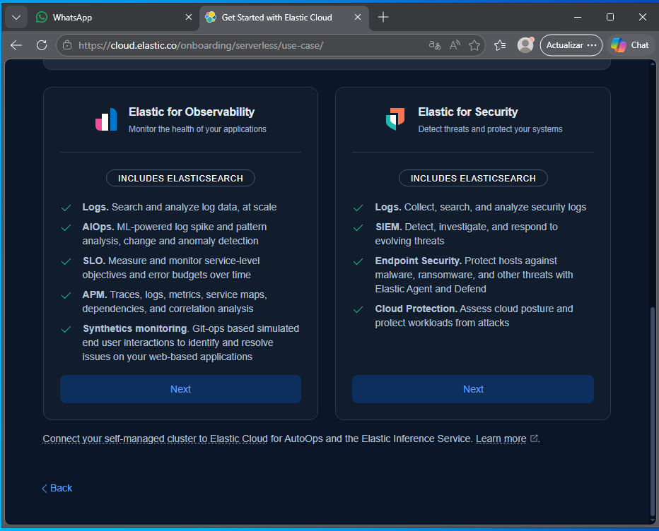

*Figura 9. Selección del caso de uso Security.*

Responde las ventanillas del asistente antes de crear el proyecto de Elastic.

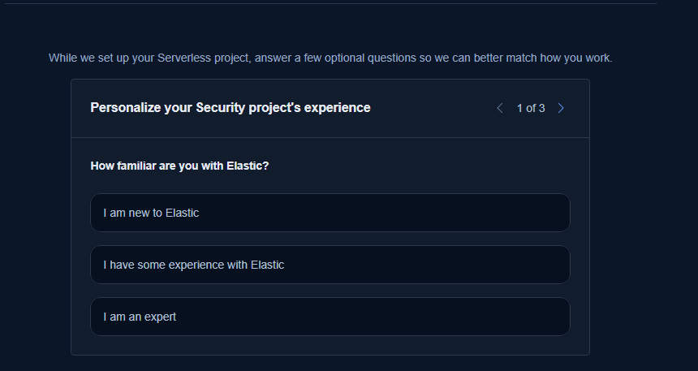

*Figura 10. Asistente de bienvenida — paso 1.*

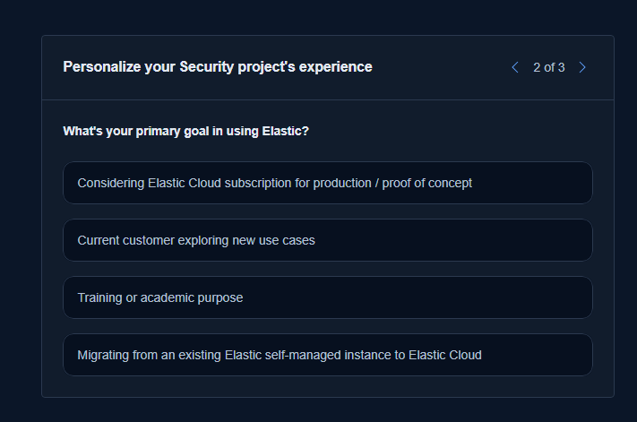

*Figura 11. Asistente de bienvenida — paso 2.*

5. Crea el proyecto de Elastic Security con un nombre (por ejemplo, `My Security project`); es Serverless y Elastic administra la infraestructura.
   Usa la ubicación asignada y pulsa **Launch** para crear el proyecto:

<p>
  <a href="https://cloud.elastic.co/"><kbd>&nbsp;Launch&nbsp;</kbd></a>
</p>

6. Espera a que termine la creación y abre el proyecto; se abre Kibana en la página **Get started**.

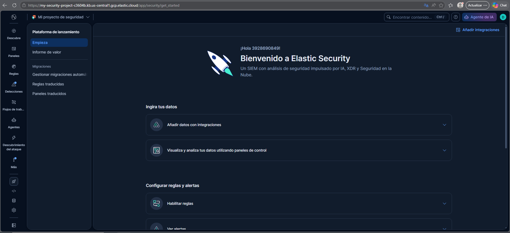

*Figura 12. Kibana abierto en la página Get started de Elastic Security.*

Los textos exactos del asistente pueden variar según la fecha, pero siempre debes terminar en un proyecto de Security con Kibana abierto.

## 4. Instalar el Elastic Agent en Windows

En los proyectos Serverless de Security, Fleet está en **Assets → Fleet**, y el Fleet Server ya viene incluido: no tienes que instalarlo.

### 4.1 Abrir Fleet

1. En el menú lateral izquierdo pulsa **More** y luego **Assets**.
2. En la sección Fleet elige **Agents**. Si no la ves, usa el buscador de arriba (`Ctrl + /`) y escribe `Fleet`.
3. Pulsa **Add agent**.

### 4.2 Configurar el agente

1. En el paso 1, usa el nombre `Agent policy 1` y pulsa **Create policy**. Deja marcada la casilla **Collect system logs and metrics**.
2. En el paso 2, deja seleccionada la opción **Enroll in Fleet**.
3. En el paso 3, abre la pestaña **Windows x86_64** y copia el script de PowerShell con el icono de copiar.

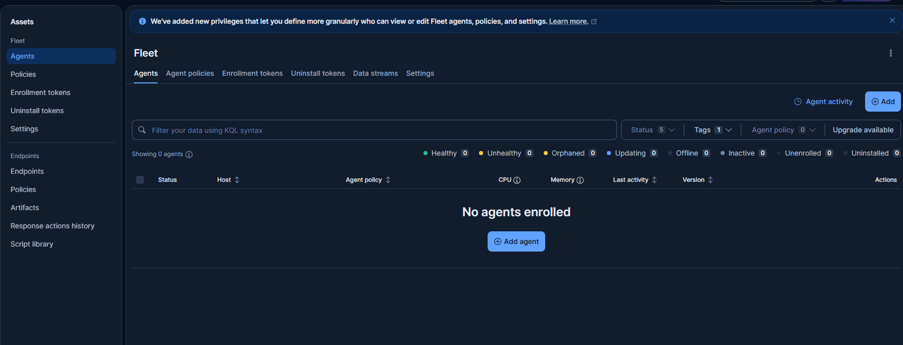

*Figura 13. Agente creado y script de instalación para Windows.*

### 4.3 Instalar en la VM

1. En la VM, abre PowerShell como Administrador.
2. Pega el script y pulsa Enter. No agregues la opción `--unprivileged`.
3. Cuando pregunte si quieres continuar con la instalación, escribe `y`.
4. Espera el mensaje final de instalación exitosa.

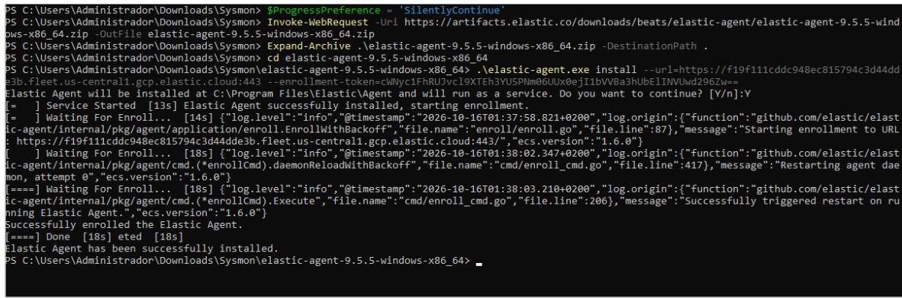

*Figura 14. Instalación del Elastic Agent en PowerShell: al final aparece «Elastic Agent has been successfully installed».*

### 4.4 Confirmar

1. Vuelve al panel de Kibana. Deben aparecer en verde **Agent enrollment confirmed** e **Incoming data confirmed**.

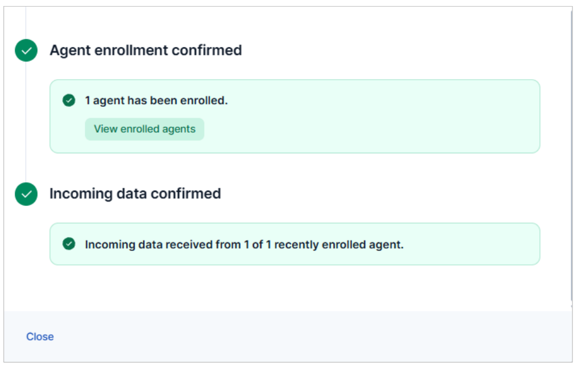

*Figura 15. Kibana confirma «Agent enrollment confirmed» e «Incoming data confirmed».*

2. Pulsa **Close**.
3. En **Fleet → Agents**, tu VM debe aparecer con estado **Healthy**.
